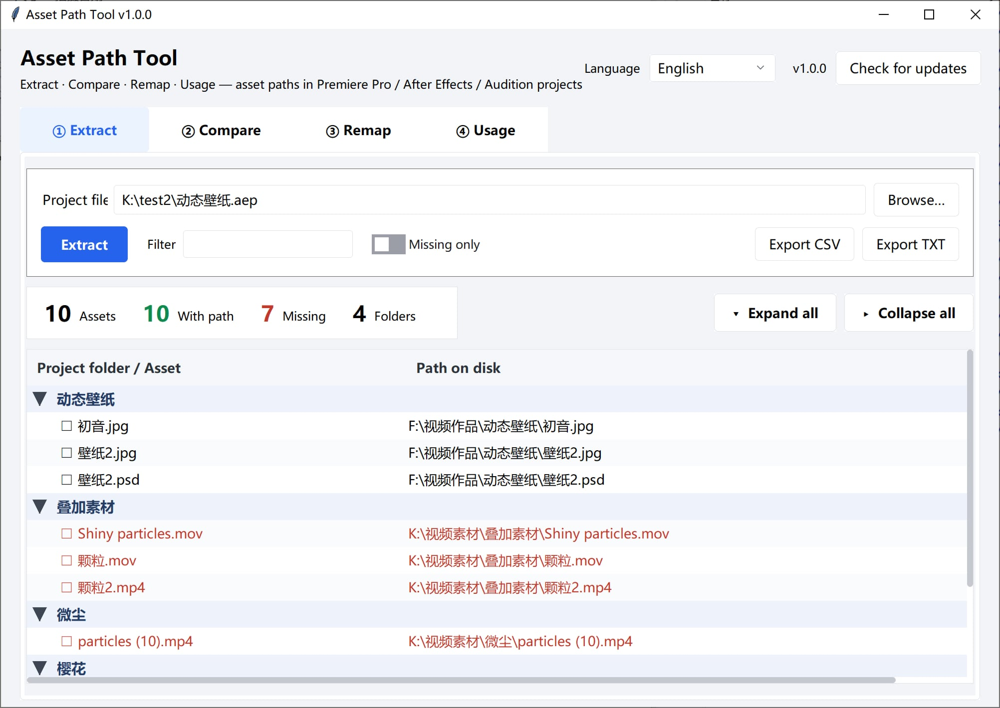

# Asset Path Tool

[English](README.md) | [简体中文](README_SC.md) | [繁體中文](README_TC.md) | [日本語](README_JP.md)

Extract asset paths from **Adobe Premiere Pro / After Effects / Audition** projects — with comparison, redirection and usage statistics.



---

## Features

| Feature | What it does |
|---|---|
| **① Extract** | Reads the "project folder → real path on disk" mapping out of `.prproj` / `.aep` / `.aepx` / `.sesx` / `.xml`, and checks whether each file still exists. Folders are shown as a collapsible tree, with expand-all / collapse-all. |
| **② Compare** | Diffs two projects and groups the result into **added / removed / path changed / location changed / unchanged**. Great for "what assets did this revision touch" or "how does the autosave differ from the main project". One click pushes the result into the Remap tab. |
| **③ Remap** | Lists every asset path, then rewrites drives in bulk with prefix rules (`D:\` → `E:\`). Rules live in their own dialog so the main screen stays clean. Double-click a row to point a single asset somewhere else. Optionally saves a rewritten copy of the project (`.prproj` / `.sesx`, **never overwrites the original**). |
| **④ Usage** | Walks the timeline and counts how often each asset is used, total duration, and which sequences it appears in — plus a list of assets used zero times. Summary by folder or by media type, disk size included. |

Also:

- **Drag & drop** — drop a project anywhere in the window; whichever input box you drop on gets filled. Drop two files on the Compare tab and they become A / B automatically.
  Drop a **folder** onto the "Find missing…" window and it fills the search directory.
- **Multi-select** — every table supports `Ctrl`-click and `Shift`-click. The first column has checkboxes; click the header to toggle all, or use the "Check / Select all / Clear all" buttons.
- **Context menu** — the Remap table and the "Find missing…" results have a right-click menu: "Choose new location…" / "Clear manual override" / "Show in Explorer".
- **Four languages** — 简体中文 / 繁體中文 / English / 日本語. On first launch it **follows the system language**; after that it remembers your choice.
- **Update check** — the version number and a "Check for updates" button sit in the header. It reads the newest release tag from GitHub (falling back to Gitee) and shows every download mirror.
- **Command line** — `--cli` gives you headless output, handy for batch jobs.
- **Zero dependencies** — pure Python standard library (tkinter / xml / gzip / csv / re / ctypes). No pip install needed.
- **Modern UI** — ships the [tkwebui](https://github.com/bvb6417/tkwebui) theme (standard library only), scales automatically on high-DPI screens.

## Supported project formats

| Application | Extension | Extract | Compare | Remap list | Rewrite | Usage |
|---|---|:---:|:---:|:---:|:---:|:---:|
| Premiere Pro | `.prproj` | ✅ | ✅ | ✅ | ✅ | ✅ |
| Premiere Pro | `.xml` (exported / unzipped XML) | ✅ | ✅ | ✅ | — | ✅ |
| After Effects | `.aep` / `.aepx` | ✅ | ✅ | ✅ | ❌ | ❌ |
| Audition | `.sesx` | ✅ | ✅ | ✅ | ✅ | ❌ |

> **Why can't `.aep` be rewritten?**
> AE projects are RIFX (big-endian RIFF) binary containers. Asset paths are scattered across escaped JSON
> blobs inside `LIST Als2`, surrounded by cross-references and length fields. Patching bytes directly
> corrupts projects far too easily, so this tool is **read-only** for `.aep`.
> Extracting the paths is already enough for backup lists and migration checks.
>
> **`.sesx` can be rewritten**: it is plain-text XML, so only the `absolutePath` attribute value inside
> the `<file>` open tag is replaced — element order, indentation, comments and line endings are preserved
> byte for byte. `id` is untouched, so the fileID ↔ path mapping stays intact.
> `relativePath` is recomputed for the new location; if the new file lands outside the session folder the
> attribute is dropped (keeping the stale one only makes Audition fight itself).
> The UTF-8 BOM is carried back as-is. **It also only writes a new file — the original session is never overwritten.**

---

## Quick start

### Option 1: download a build (recommended)

Grab the right build for your platform from [Releases](https://github.com/SaraKale/AssetPathTool/releases):

| Platform | Pick |
|---|---|
| Windows | `windows-x64` (almost every PC); Snapdragon laptops use `windows-arm64` |
| macOS | `macos-arm64` (M1/M2/M3/M4); Intel Macs use `macos-x64` |
| Linux | `linux-x64` or `linux-arm64` |

On Windows / Linux just unzip and run `AssetPathTool` (keep the whole folder — don't copy the exe on its
own, `_internal` has to come along).

Mirrors, if GitHub is slow from where you are:

| Mirror | Link |
|---|---|
| GitHub | https://github.com/SaraKale/AssetPathTool/releases |
| Gitee | https://gitee.com/sarakale/AssetPathTool/releases |
| Lanzou | https://wwavg.lanzoum.com/b0rbjanfg (password `914k`) |
| MediaFire | https://www.mediafire.com/folder/1ik8qiblrl7s1/AssetPathTool |

> If macOS says "cannot verify the developer" on first launch: right-click → Open, or run
> `xattr -dr com.apple.quarantine /path/to/AssetPathTool.app` in Terminal.

### Option 2: run from source

Requires Python 3.9+ (3.11 or newer recommended) with tkinter.

```bash
git clone https://github.com/SaraKale/AssetPathTool
cd AssetPathTool
python AssetPathToolMain.py
```

On Windows, if tkinter is missing, reinstall from the official installer and tick `tcl/tk and IDLE`.

---

## Command line usage

```bash
# Extract (.prproj / .aep / .sesx / .xml all work)
python AssetPathToolMain.py --cli project.prproj
python AssetPathToolMain.py --cli motion.aep
python AssetPathToolMain.py --cli voiceover.sesx

# Compare two projects
python AssetPathToolMain.py --cli old.prproj new.prproj --diff

# Remap paths (repeatable, one rule per pair)
python AssetPathToolMain.py --cli project.prproj --remap "D:\old-assets" "E:\new-assets"

# Usage statistics
python AssetPathToolMain.py --cli project.prproj --usage

# Common flags
--csv                  also export CSV
-o out.txt             write to a specific file
--rewrite out.prproj   save a rewritten copy of the project (original untouched)
--all                  include sequences / adjustment layers in the comparison
```

---

## The interface

### ① Extract

Pick a project, then click **Extract**. The four numbers on top are the overview: assets / with path /
missing on disk / folders.

- Type into the **Filter** box to narrow by folder name, asset name or path in real time;
- Tick **Missing only** to keep just the files that aren't on this machine;
- The `▼ / ▶` markers on the left are clickable, and so are **Expand all / Collapse all** in the corner;
- The `☐` in front of each asset name toggles its checkbox, handy for marking a batch.

### ② Compare

Put the old version in A and the new one in B, then click **Compare**. The badges on top show how many
entries fall into each of the five categories; **Show** lets you narrow down to one category.

Sequences and adjustment layers have no source file, so they are ignored by default (otherwise the result
is mostly noise). Tick **Include source-less entries (sequences, adjustment layers, …)** if you want them.

**Comparison feeds straight into remapping**: click **Fill into Remap** and every "path changed" row from
this comparison is pushed into the Remap tab — no more copying old/new prefixes out of the report by hand.
If the Remap tab has no project loaded yet, A (the old project) is loaded first so you can hit "Load all";
if the two sides aren't the same project, it asks first.
To turn the changes into prefix rules as well (so assets added later get remapped automatically), tick
**Also distil prefix rules** — a whole-drive move or a folder relocation usually needs just one rule.

### ③ Remap

1. Pick a project → click **Load all**, and every asset is listed below;
2. Click **Rules…** to open the rules dialog: fill in **old prefix / new prefix** → **+ Add rule**.
   Rules match **top to bottom, first hit wins**; use **Move up / Move down** to change priority;
3. Close the dialog (or hit **Apply rules** right there) → click **Apply rules** on the main screen;
4. To pin a single asset: **double-click its row** and pick the new file. The context menu offers
   **Choose new location…** / **Clear manual override** / **Show in Explorer**;
5. When a path can't be resolved, click **Find missing…**, pick an asset folder and match by
   **file-name prefix** (different extensions still match — `flv/mp4/mov` are treated as the same thing).
   Results with a score of 85% or higher are checked automatically;
6. Once everything looks right, **Export list** for the path list, or **Export new file** to save a
   rewritten copy of the project (**the original is never overwritten**).

**Export buttons** (top right, left to right):

| Button | Output |
|---|---|
| **Export new file** | The rewritten project: `.prproj` or `.sesx` (chosen from the source type). It asks where to save first; picking the original path is blocked |
| Export list | `_remap.txt`, the old → new path table (if "also save the rewritten project" is ticked in the rules dialog, the project file comes along) |
| Export CSV | `_remap.csv`, a detail table for Excel |

**The "Find missing…" window has a context menu too**: `Use this suggestion` / `Choose new location…` /
`Show in Explorer`. "Use this suggestion" applies only the row you right-clicked; "Choose new location…"
bypasses matching and lets you pick a file directly; "Show in Explorer" opens the folder with the file selected.

Besides the asset name and score, the results table also lists the candidate's **size** and
**modification time** — same name, different versions is far too common (4K remaster, compressed copy,
exported twice), and file name plus score alone can't tell them apart. Those two columns settle it at a glance.

> **Click "Apply to Remap" with no rows selected = apply everything** (best candidate per asset).
> To change only some of them, `Ctrl` / `Shift`-select those rows first.
>
> A missing asset can produce several candidates (short names especially — anything sharing a series
> Those aren't duplicate rows, they're alternatives for the same
> asset. "Keep only the best candidate per asset" is on by default and hides the low scorers; untick it to
> see them all, with the 2nd and later rows of the same asset labelled `└ alt` and grouped together.
>
> The `☐` in the first column scopes the "Find missing…" run: if any rows are checked only those are
> processed, otherwise the selected rows, and if neither, every missing asset.
>
> Three buttons handle bulk checking:
> - **Check** — ticks the rows currently selected with `Ctrl` / `Shift`;
> - **Select all** — ticks the rows **visible** after the current "Show" filter (filtered-out rows are left alone);
> - **Clear all** — clears **including the filtered-out rows**, so nothing is left behind.
>
> "Clear manual override" clears **manually assigned new paths** (the ones set by double-click / context
> menu). Those rows go back to being computed from the rules — it has nothing to do with checkboxes or filters.

> ⚠️ Back up your project before rewriting. The output is always a new file; not a single byte of the
> original is touched.

### ④ Usage

Pick a `.prproj` → **Compute**. The badges give you total assets / used / never used / sequence count /
total timeline duration.

The **View** switch in the top right:

| View | What you see |
|---|---|
| **Per asset** | One row per asset: times used, total duration, which sequences it appears in |
| **By folder** | One group per project folder: how many assets, how many unused, total disk size |
| **By type** | Grouped by video / audio / image, same columns |

"By folder" is the most practical one: when the disk is filling up, see which folder eats the most and how
much of it was never used (in one measured 1152-asset project, a single folder with 42 assets took 194 GB).
The **Show** filter applies to the summary views too, so you can look at "never used" groups only.

**Dragging a folder**: drop a folder onto the "Find missing…" window and it fills the search directory;
if that window isn't open, dropping a folder on the main window forwards it there (or tells you to open it first).

---

## Languages

The interface ships in 简体中文, 繁體中文, English and 日本語. Switch any time from the dropdown in the top
right — the window is **not rebuilt**, so paths in the inputs and data in the tables survive.

On first launch it reads the system UI language; after that it remembers your choice, and the config file
lives **next to the program** where you can find it:

| How you run it | Config file location |
|---|---|
| Packaged build | Same folder as `AssetPathTool.exe`: `AssetPathTool.config.json` |
| From source | Project root: `AssetPathTool.config.json` |
| Program folder not writable (Program Files, inside a macOS `.app`, `/usr/local`) | `%APPDATA%\AssetPathTool\config.json` (macOS/Linux: `~/.config/AssetPathTool/`) |

It's a portable app at heart, so **copy the whole folder to another machine and the language setting comes
with it**. To go back to "follow the system", delete the file and start again.

To add a language: add a row to `LANGS` in `src/i18n.py`, then append one column to every entry in `_T`.

---

## Building

### Locally

```bash
pip install pyinstaller
pyinstaller AssetPathTool.spec --noconfirm
```

The output lands in `dist/AssetPathTool/`.

A few key points in the `.spec`:

| Item | Value | Why |
|---|---|---|
| `ONEFILE` | `False` | Folder builds start fast; `True` gives a single exe (1–3 s slower on first launch) |
| Version | Read from `APP_VER` in `src/appinfo.py` | Single source of truth — the exe version resource and the title bar never disagree |
| `hiddenimports` | `collect_submodules("tkwebui")` + `collect_submodules("src")` | Theme and page modules are loaded dynamically and would otherwise be missed |
| `excludes` | numpy / pandas / PyQt / PIL … | Trims 200 MB+ down to **31 MB** |
| `console` | `False` | No console window for the GUI; `--cli` reattaches to the console by itself |

### GitHub Actions

`.github/workflows/build-app.yml` is ready to go, with a six-platform matrix:

```
Windows x64 / Windows ARM64 / macOS Intel / macOS ARM64 / Linux x64 / Linux ARM64
```

How to trigger it:

- **Push a tag**: `git tag v1.0.0 && git push origin v1.0.0` → builds and creates a **Draft Release**;
- **Manually**: Actions page → Build Asset Path Tool → Run workflow, put the version in `release_tag`
  (leave it empty to produce artifacts only, no Release).

---

## Project layout

```
AssetPathToolMain.py        Entry point (GUI / CLI dispatch)
AssetPathTool.spec          PyInstaller build config
src/
  appinfo.py                App name / version / config location
  i18n.py                   Four-language string table + system language detection
  theme.py                  Palette + ttk styles + tkwebui detection
  platform_utils.py         DPI / console attach / file drag & drop
  cli.py                    Command line mode
  core/                     Pure parsing logic (no tkinter)
    prproj.py               .prproj / .xml parsing
    aep.py                  .aep / .aepx parsing (RIFX + gzip XML)
    sesx.py                 .sesx (Audition) parsing + rewriting
    loader.py               Dispatch by extension (both extract and rewrite)
    usage.py                Timeline usage stats + grouped summaries
    diff.py                 Two-project diff + prefix rule distillation
    remap.py                Prefix remapping + .prproj rewriting
    matching.py             Find missing assets by file name
    fsinfo.py               File size / modification time
    update.py               Fetch the newest GitHub / Gitee release tag
  ui/                       Interface layer
    app.py                  Window shell / language switching / background tasks
    kit.py                  Shared widget factory
    page_extract.py         ① Extract
    page_diff.py            ② Compare
    page_remap.py           ③ Remap
    page_usage.py           ④ Usage
    finder.py               The "Find missing…" window
    update_win.py           The "Check for updates" window
tkwebui/                    UI theme library (MIT, distributed with the project)
```

`src/core/` never imports tkinter, so it works standalone in scripts and unit tests:

```python
from src.core.loader import extract_any
for r in extract_any("project.prproj"):
    print(r["folder"], r["name"], r["exists"])
```

---

## Notes

- **`.prproj` is gzip-compressed XML** (magic `1f 8b`). The tool unpacks it for you; no manual steps.
- **Rewriting a `.prproj` only writes a new file** — the original is never modified. Rewriting is still an
  experimental feature, so **please back up first**, and open the result in Premiere to confirm every asset is online.
- **Whether an asset "exists" depends on the machine running the tool.** A list produced on computer A will
  show different missing counts on computer B. That's expected.
- **Large projects take time.** Parsing 1000+ assets takes about 1–2 seconds; "Find missing…" scanning an
  asset drive with hundreds of thousands of files takes longer, and the tool will ask you to narrow the scope first.
- **`.aep` is read-only**, see above. `.prproj` / `.sesx` can be saved as rewritten copies, but the
  **original file is never overwritten**.
- **The config file** is `AssetPathTool.config.json` next to the program. It only stores the UI language;
  delete it to reset to defaults.

## FAQ

**Q: It says tkinter is missing.**
On Windows, reinstall from the python.org installer and tick `tcl/tk and IDLE`; on Ubuntu run
`sudo apt install python3-tk`; on macOS use the python.org build (brew's python sometimes ships without tk).

**Q: The packaged exe prints nothing with `--cli`.**
An exe built with `console=False` has no console when double-clicked. Run it from cmd / PowerShell, or use
`-o` to write to a file. Note that Git Bash / MinTTY is a pty and can't attach to the Win32 console.

**Q: Can it extract Premiere's `.xml`?**
Yes — just pick the `.xml` file.

**Q: Can it extract Audition's `.sesx`?**
Yes, drag it in exactly like a `.prproj`. `.sesx` is plain-text XML where the path lives in the
`absolutePath` **attribute** of the `<file>` element (not a child tag), with the relative path in
`relativePath`. The tool reads both, plus an absolute-path regex as a last resort, and tries UTF-8 /
GB18030 / UTF-16 encodings. Audition has no "project folders" like Premiere, so the list groups by
**the asset's own directory**.

**Q: `.sesx` extraction comes back empty?**
Early versions only scanned the `<filePath>` child tag, while real Audition sessions use the
`absolutePath` attribute, so nothing was found — fixed in v1.0.0. If it's still empty, the tool pops up an
explicit explanation (project references no external assets / unsupported format / corrupted file).

**Q: Can Audition's `.sesx` be rewritten?**
Yes. Only the `absolutePath` attribute value inside the `<file>` open tag is replaced; `id`, element order,
indentation, comments and line endings are all preserved, and the UTF-8 BOM is written back.
`relativePath` is recomputed for the new location; if the new file lands outside the session folder the
attribute is dropped — keeping the stale relative path only makes Audition fight itself.
Tested against a real session: all 6 paths hit, the result parses again, and not a single `id` changed.

**Q: Will it modify my project files?**
Extract, compare and usage are all read-only. Rewriting only happens on "Export new file" or when
"also save the rewritten project" is ticked, and it always writes to a new path — even if you pick the
original, it's blocked.

**Q: How does "Check for updates" work?**
It reads the newest release tag from the GitHub API, falls back to Gitee when GitHub is unreachable, and
compares it against the version baked into the build. Each release tag is `v<APP_VER>`, so the comparison
is purely numeric. Nothing is downloaded or installed automatically — the window just gives you the
download mirrors.

---

## License

[MIT](LICENSE)

The UI theme [tkwebui](https://github.com/bvb6417/tkwebui) is MIT-licensed as well and is distributed
together with the project.
