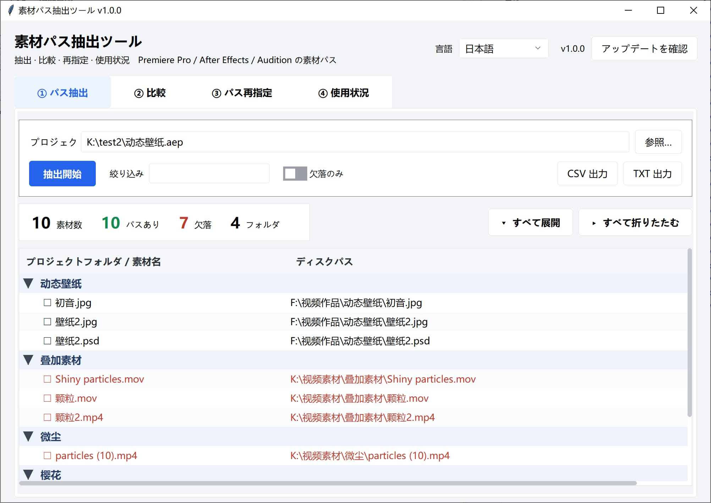

# 素材パス抽出ツール · Asset Path Tool

[English](README.md) | [简体中文](README_SC.md) | [繁體中文](README_TC.md) | [日本語](README_JP.md)

**Adobe Premiere Pro / After Effects / Audition** のプロジェクトから素材パスを抽出し、比較・再指定・使用状況の集計まで行えるツールです。



---

## 主な機能

| 機能 | 内容 |
|---|---|
| **① パス抽出** | `.prproj` / `.aep` / `.aepx` / `.sesx` / `.xml` から「プロジェクトフォルダ → ディスク上の実際のパス」を読み出し、ファイルが今もディスクにあるかも確認します。フォルダはツリーで折りたたみ表示、すべて展開 / すべて折りたたむにも対応。 |
| **② プロジェクト比較** | 2 つのプロジェクトを突き合わせ、**追加 / 削除 / パス変更 / 場所変更 / 変更なし**に分類して一覧にします。「今回の改訂でどの素材が動いたか」「自動保存のコピーと本体の違い」を調べるのに便利。比較後はワンクリックで再指定タブへ流し込めます。 |
| **③ パス再指定** | まず全素材パスを一覧化し、プレフィックスルールでまとめてドライブを差し替えます（`D:\` → `E:\`）。ルールは「ルール一覧…」ダイアログにまとめてあり、メイン画面を圧迫しません。行をダブルクリックすれば 1 件だけ個別に指定できます。書き換え済みプロジェクトを別名保存することも可能（`.prproj` / `.sesx`、**元ファイルは絶対に上書きしません**）。 |
| **④ 使用状況** | タイムラインを解析し、各素材が何回使われたか・合計時間・どのシーケンスに出てくるかを集計。「一度も使われていない」素材も洗い出します。フォルダ別 / 種類別の集計にも対応し、占有サイズも一緒に計算します。 |

その他：

- **ドラッグ＆ドロップ** — プロジェクトをウィンドウへ放り込むだけ。落とした入力欄にそのまま入ります。比較タブに 2 つ同時に落とすと自動で A / B に振り分け。
  **フォルダ**を「欠落を検索…」ウィンドウに落とすと検索ディレクトリに入ります。
- **複数選択** — すべての表で `Ctrl` クリック / `Shift` クリックに対応。先頭列にはチェックボックスがあり、見出しをクリックで全選択、「チェック / すべて選択 / すべて解除」の 3 ボタンでも操作できます。
- **右クリックメニュー** — 再指定の表と「欠落を検索…」の結果表で右クリック。「新しい場所を選択…」/「手動指定をクリア」/「エクスプローラーで表示」が使えます。
- **4 言語** — 简体中文 / 繁體中文 / English / 日本語。初回起動時は**システム言語に自動追従**し、以降は選択を記憶します。
- **アップデート確認** — ヘッダー右側にバージョン番号と「アップデートを確認」ボタン。GitHub（つながらない場合は Gitee）の最新 Release タグを読み、各プラットフォームのダウンロード先を一覧表示します。
- **コマンドライン** — `--cli` で画面なし実行。バッチ処理に向いています。
- **依存ゼロ** — Python 標準ライブラリのみ（tkinter / xml / gzip / csv / re / ctypes）。pip でのインストールは不要です。
- **モダンな UI** — [tkwebui](https://github.com/bvb6417/tkwebui) テーマを同梱（標準ライブラリ実装）。高 DPI 画面でも自動でスケーリングします。

## 対応プロジェクト形式

| アプリ | 拡張子 | 抽出 | 比較 | 再指定リスト | 書き換え | 使用状況 |
|---|---|:---:|:---:|:---:|:---:|:---:|
| Premiere Pro | `.prproj` | ✅ | ✅ | ✅ | ✅ | ✅ |
| Premiere Pro | `.xml`（書き出し / 解凍した XML） | ✅ | ✅ | ✅ | — | ✅ |
| After Effects | `.aep` / `.aepx` | ✅ | ✅ | ✅ | ❌ | ❌ |
| Audition | `.sesx` | ✅ | ✅ | ✅ | ✅ | ❌ |

> **`.aep` を書き換えられない理由**
> AE プロジェクトは RIFX（ビッグエンディアン RIFF）のバイナリコンテナで、素材パスは `LIST Als2` の
> 中に散らばるエスケープ済み JSON の断片に存在し、さらに大量の相互参照と長さフィールドが絡んでいます。
> バイトを直接書き換えると破損しやすいため、本ツールは `.aep` を**読み取り専用**として扱います。
> パスの抽出ができれば、バックアップ一覧や移行確認には十分です。
>
> **`.sesx` は書き換え可能**：プレーンテキストの XML なので、`<file>` 開始タグ内の `absolutePath`
> 属性値だけを置換します。要素の順序・インデント・コメント・改行コードはそのまま保持し、`id` も
> 変更しないため fileID ↔ パスの対応は崩れません。`relativePath` は新しい場所に合わせて再計算し、
> 新しいファイルがセッションフォルダの外に出る場合はこの属性を削除します（古い相対パスを残すと
> Audition 側で食い違うため）。UTF-8 BOM もそのまま書き戻します。
> **こちらも新しいファイルを書くだけで、元のセッションは上書きしません。**

---

## はじめかた

### 方法 1：ビルド済み版をダウンロード（推奨）

[Releases](https://github.com/SaraKale/AssetPathTool/releases) からプラットフォームに合うものを取得してください：

| プラットフォーム | 選ぶもの |
|---|---|
| Windows | `windows-x64`（ほとんどの PC）。Snapdragon 搭載ノートは `windows-arm64` |
| macOS | `macos-arm64`（M1/M2/M3/M4）。Intel Mac は `macos-x64` |
| Linux | `linux-x64` または `linux-arm64` |

Windows / Linux は解凍してそのまま `AssetPathTool` を実行（フォルダ版です。exe だけをコピーせず、
`_internal` も一緒に持っていってください）。

GitHub が遅い場合はミラーもどうぞ：

| ミラー | リンク |
|---|---|
| GitHub | https://github.com/SaraKale/AssetPathTool/releases |
| Gitee | https://gitee.com/sarakale/AssetPathTool/releases |
| 藍奏雲 | https://wwavg.lanzoum.com/b0rbjanfg（パスワード `914k`） |
| MediaFire | https://www.mediafire.com/folder/1ik8qiblrl7s1/AssetPathTool |

> macOS で初回起動時に「開発元を検証できません」と出たら、右クリック → 開く、またはターミナルで
> `xattr -dr com.apple.quarantine /path/to/AssetPathTool.app` を実行してください。

### 方法 2：ソースから実行

Python 3.9 以上（3.11 以降推奨）と tkinter が必要です。

```bash
git clone https://github.com/SaraKale/AssetPathTool
cd AssetPathTool
python AssetPathToolMain.py
```

Windows で tkinter が無いと言われたら、公式インストーラーで入れ直し、`tcl/tk and IDLE` にチェックを入れてください。

---

## コマンドラインでの使い方

```bash
# 抽出（.prproj / .aep / .sesx / .xml すべて可）
python AssetPathToolMain.py --cli project.prproj
python AssetPathToolMain.py --cli motion.aep
python AssetPathToolMain.py --cli voiceover.sesx

# 2 つのプロジェクトを比較
python AssetPathToolMain.py --cli old.prproj new.prproj --diff

# パスの再指定（ルールは何度でも指定可）
python AssetPathToolMain.py --cli project.prproj --remap "D:\old-assets" "E:\new-assets"

# 使用状況
python AssetPathToolMain.py --cli project.prproj --usage

# よく使うオプション
--csv                  CSV も同時に書き出す
-o out.txt             出力ファイルを指定
--rewrite out.prproj   書き換え済みプロジェクトを別名保存（元ファイルは変更しません）
--all                  比較時にシーケンス / 調整レイヤーなどソースを持たない項目も含める
```

---

## 画面の説明

### ① パス抽出

プロジェクトを選んで「抽出開始」をクリック。上部の 4 つの数字が概要です：素材数 / パスあり /
ディスク上に無い / フォルダ数。

- 「絞り込み」欄にキーワードを入れると、フォルダ名・素材名・パスでリアルタイムに絞れます；
- 「欠落のみ」にチェックすると、この PC で見つからないものだけになります；
- 左側の `▼ / ▶` は直接クリックでき、右上の「すべて展開 / すべて折りたたむ」でも操作できます；
- 素材名の先頭にある `☐` をクリックするとチェックが付き、まとめて選ぶのに便利です。

### ② プロジェクト比較

A に旧版、B に新版を入れて「比較開始」。上部のバッジに 5 分類それぞれの件数が出ます。「表示」で 1 種類だけに絞り込めます。

シーケンスや調整レイヤーはソースファイルを持たないため、既定では除外されます（含めるとノイズで埋もれるため）。
必要なら「シーケンス／調整レイヤーなどソースなし項目を含める」にチェックしてください。

**比較結果はそのまま再指定に渡せます**：「再指定表へ流し込む」を押すと、今回の「パス変更」が 1 件ずつ
再指定タブに入ります。レポートを見ながら旧プレフィックス / 新プレフィックスを書き写す必要はありません。
再指定タブにまだプロジェクトが読み込まれていない場合は、先に A（旧プロジェクト）を入れて
「すべて読み込む」を押せる状態にします。両者が別プロジェクトの場合は先に確認します。
ついでに変更内容をプレフィックスルールにまとめたい場合（今後追加される素材にも自動適用されます）は、
「同時にプレフィックスルールを抽出」にチェックしてください。ドライブごと差し替える / フォルダを移す、
といったケースは通常 1 本のルールで足ります。

### ③ パス再指定

1. プロジェクトを選ぶ → 「すべて読み込む」で全素材が一覧に出ます；
2. 「ルール一覧…」でルールダイアログを開き、「元のパスプレフィックス / 新しいパスプレフィックス」を入れて
   「+ ルールを追加」。ルールは**上から順に照合し、最初に一致したものが適用**されます。
   「上へ / 下へ」で優先順位を調整できます；
3. ダイアログを閉じる（またはその場で「ルールを適用」）→ メイン画面で「ルールを適用」を押して一括変換；
4. 個別に指定したい場合は**その行をダブルクリック**して新しいファイルを選択。右クリックから
   「新しい場所を選択…」/「手動指定をクリア」/「エクスプローラーで表示」も使えます；
5. パスが合わないときは「欠落を検索…」を押し、素材フォルダを選んで**ファイル名のプレフィックス**で照合します
   （拡張子が違っても一致とみなします。`flv/mp4/mov` は相互に一致）。類似度 85% 以上の結果は自動でチェックされます；
6. 問題なければ「リストを書き出す」でパス一覧を取得するか、「新しいファイルを書き出す」で
   書き換え済みプロジェクトを別名保存します（**元のプロジェクトは上書きしません**）。

> **ルールが効くのは「いま読み込んでいるプロジェクト」だけです。** 別のプロジェクトを読み込むと、
> 表はそのプロジェクト自身の元のパスに戻ります（前のルールが勝手に適用されることはありません）。
> ルール表のルールは残るので、再利用したいときはもう一度「ルールを適用」を押してください。
> 手動指定した新しい場所がある状態で別のプロジェクトを読み込む場合は、先に確認が出ます。

**書き出しボタン**（右上、左から）：

| ボタン | 出力 |
|---|---|
| **新しいファイルを書き出す** | 書き換え済みプロジェクト：`.prproj` または `.sesx`（元ファイルの種類で自動判定）。保存先を先に聞かれ、元のプロジェクトを選ぶとブロックされます |
| リストを書き出す | `_remap.txt` のパス対応表（ルールダイアログで「書き換え後のプロジェクトも保存」にチェックしているとプロジェクトファイルも一緒に出ます） |
| CSV を書き出す | `_remap.csv` の明細表。Excel 用 |

**「欠落を検索…」ダイアログでも右クリック可**：`この候補を採用` / `新しい場所を選択…` / `エクスプローラーで表示`。
「この候補を採用」は右クリックした行だけに適用されます。「新しい場所を選択…」は照合結果を無視して
直接ファイルを指定できます。「表示」はエクスプローラーを開いてファイルを選択状態にします。

結果表には素材名と類似度だけでなく、候補ファイルの**サイズ**と**更新日時**も出ます。
同名で別バージョンというのはよくあること（4K 修復版、圧縮版、二度書き出したもの）で、
ファイル名と類似度だけでは判断できません。この 2 列があれば一目で判別できます。

> **何も選択せずに「再指定表に適用」を押すと全件適用**（各素材の最良候補を採用）。
> 一部だけ変えたいときは `Ctrl` / `Shift` でその行を選んでから押してください。
>
> 欠落素材は複数の候補が出ることがあります（短い名前ほど顕著で）
> プレフィックスが付いていると全部一致します）。これは重複行ではなく、同じ素材の代替候補です。
> 既定で「各素材は最良候補のみ残す」がオンになっており、低スコアの候補は非表示です。
> チェックを外すと全件表示になり、同じ素材の 2 件目以降は素材名列に `└ 代替` と付いて並びます。
>
> 表の先頭列の `☐` は「欠落を検索…」の対象範囲を決めます。チェックした行があればその行だけ、
> なければ選択中の行、どちらも無ければ欠落素材すべてが対象です。
>
> 一括チェックは「チェック / すべて選択 / すべて解除」の 3 ボタン：
> - **チェック** — 表で `Ctrl` / `Shift` 選択している行にチェックを入れます；
> - **すべて選択** — 現在の「表示」で絞り込んだ後に**見えている**行にチェック（絞り込まれて非表示の行はそのまま）；
> - **すべて解除** — **絞り込まれて非表示の行も含めて**すべて解除。残しません。
>
> 「手動指定をクリア」が消すのは**手動で指定した新しいパス**（ダブルクリック / 右クリックで選んだもの）です。
> クリアした行はルールから再計算されます。チェックや絞り込みとは無関係です。

> ⚠️ 書き換え前にプロジェクトをバックアップしてください。出力は常に新しいファイルで、元のプロジェクトは
> 1 バイトも変更しません。

### ④ 使用状況

`.prproj` を選んで「集計開始」。バッジに素材総数 / 使用済み / 未使用 / シーケンス数 / タイムライン合計時間が出ます。

右上の「表示」で切り替え：

| 表示 | 内容 |
|---|---|
| **1 件ずつ** | 素材ごとに 1 行：使用回数、合計時間、登場するシーケンス |
| **フォルダ別** | プロジェクトフォルダごとに 1 グループ：素材数、未使用数、合計サイズ |
| **種類別** | 映像 / 音声 / 画像でグループ化。内容は同上 |

「フォルダ別」が一番実用的です。ディスクが一杯に近づいたとき、どのフォルダが最も容量を食っていて、
そのうちどれだけが一度も使われていないかが分かります（実測で 1152 素材のプロジェクトにおいて、
あるフォルダは 42 素材で 194 GB を占めていました）。
「表示」の絞り込みは集計ビューにも効くので、「未使用」のグループだけを見ることもできます。

**フォルダのドラッグ**：「欠落を検索…」ウィンドウにフォルダを落とすと検索ディレクトリに入ります。
ウィンドウが開いていないときにメイン画面へ落としても転送されます（開いていなければ先に開くよう案内します）。

---

## 多言語

画面は 简体中文 / 繁體中文 / English / 日本語 に対応しています。右上のドロップダウンでいつでも切り替えられ、
**ウィンドウは再構築されません**。入力欄のパスも表のデータもそのまま残ります。

初回起動時はシステムの UI 言語を読んで自動選択し、以降は選択を記憶します。設定ファイルは
**プログラムの隣**に置かれるので見つけやすいです：

| 実行方法 | 設定ファイルの場所 |
|---|---|
| パッケージ版 | `AssetPathTool.exe` と同じフォルダ：`AssetPathTool.config.json` |
| ソースから実行 | プロジェクトルート：`AssetPathTool.config.json` |
| プログラムフォルダが書き込み不可（Program Files、macOS `.app` 内部、`/usr/local`） | `%APPDATA%\AssetPathTool\config.json`（macOS/Linux は `~/.config/AssetPathTool/`） |

ポータブル前提なので、**フォルダごと別の PC にコピーすれば言語設定も一緒に移動します**。
「システムに追従」に戻したいときは、このファイルを削除して再起動してください。

言語を追加するには：`src/i18n.py` の `LANGS` に 1 行追加し、`_T` の各項目に 1 列追加します。

---

## ビルド

### ローカルでビルド

```bash
pip install pyinstaller
pyinstaller AssetPathTool.spec --noconfirm
```

出力は `dist/AssetPathTool/` に生成されます。

`.spec` の要点：

| 項目 | 値 | 理由 |
|---|---|---|
| `ONEFILE` | `False` | フォルダ版は起動が速い。`True` にすると単一 exe（初回起動が 1〜3 秒遅くなる） |
| バージョン | `src/appinfo.py` の `APP_VER` から取得 | 唯一の情報源。exe のバージョンリソースとタイトルバーが常に一致します |
| `hiddenimports` | `collect_submodules("tkwebui")` + `collect_submodules("src")` | テーマとページのモジュールは動的に読み込まれるため、明示しないと漏れます |
| `excludes` | numpy / pandas / PyQt / PIL … | 200MB+ から **31MB** まで削減 |
| `console` | `False` | GUI に黒い窓を出さない。`--cli` モードでは内部でコンソールに接続し直します |

### GitHub Actions

`.github/workflows/build-app.yml` は設定済みで、6 プラットフォームのマトリクスに対応：

```
Windows x64 / Windows ARM64 / macOS Intel / macOS ARM64 / Linux x64 / Linux ARM64
```

トリガー方法：

- **タグを push**：`git tag v1.0.0 && git push origin v1.0.0` → 自動ビルドして **Draft Release** を作成；
- **手動**：Actions ページ → Build Asset Path Tool → Run workflow。`release_tag` にバージョンを記入
  （空欄なら artifact のみ生成し、Release は作りません）。

---

## プロジェクト構成

```
AssetPathToolMain.py        エントリポイント（GUI / CLI の振り分け）
AssetPathTool.spec          PyInstaller ビルド設定
src/
  appinfo.py                アプリ名 / バージョン / 設定ディレクトリ
  i18n.py                   4 言語の文言テーブル + システム言語判定
  theme.py                  カラーパレット + ttk スタイル + tkwebui 検出
  platform_utils.py         DPI / コンソール接続 / ファイルドラッグ＆ドロップ
  cli.py                    コマンドラインモード
  core/                     純粋な解析ロジック（tkinter 非依存）
    prproj.py               .prproj / .xml の解析
    aep.py                  .aep / .aepx の解析（RIFX + gzip XML）
    sesx.py                 .sesx（Audition）の解析 + 書き換え
    loader.py               拡張子による振り分け（抽出 / 書き換えの両方）
    usage.py                タイムライン使用状況の集計 + グループ集計
    diff.py                 2 プロジェクトの比較 + 再指定ルールの抽出
    remap.py                プレフィックス再指定 + .prproj の書き換え
    matching.py             ファイル名による欠落素材の検索
    fsinfo.py               ファイルサイズ / 更新日時
    update.py               GitHub / Gitee の最新 Release タグ取得
  ui/                       画面層
    app.py                  メインウィンドウの骨組み / 言語切替 / バックグラウンド処理
    kit.py                  共通ウィジェットファクトリ
    page_extract.py         ① 抽出
    page_diff.py            ② 比較
    page_remap.py           ③ 再指定
    page_usage.py           ④ 使用状況
    finder.py               「欠落を検索…」ダイアログ
    update_win.py           「アップデートを確認」ダイアログ
tkwebui/                    画面テーマライブラリ（MIT、プロジェクトに同梱）
```

`src/core/` は tkinter を import しないので、スクリプトやユニットテストに単独で使えます：

```python
from src.core.loader import extract_any
for r in extract_any("project.prproj"):
    print(r["folder"], r["name"], r["exists"])
```

---

## 注意事項

- **`.prproj` は gzip 圧縮された XML**（マジック `1f 8b`）です。本ツールが自動で解凍するので、手動での
  展開は不要です。
- **`.prproj` の書き換えは新しいファイルを書くだけ**で、元のプロジェクトは変更されません。ただし書き換えは
  実験的な機能です。**必ずバックアップを取り**、生成物を Premiere で開いて素材がすべてオンラインか確認してください。
- **素材が「存在する」かどうかは、本ツールを実行している PC 次第**です。PC A で作った一覧を PC B で見ると
  欠落数が変わりますが、これは正常です。
- **大きなプロジェクトには時間がかかります**。1000 素材以上の解析は 1〜2 秒程度。「欠落を検索」で
  数十万ファイルの素材ディスクを走査するとさらに時間がかかるため、先に対象を絞るよう案内が出ます。
- **`.aep` は読み取り専用**です（上記参照）。`.prproj` / `.sesx` は書き換え版を別名保存できますが、
  **元ファイルを上書きすることはありません**。
- **設定ファイル**はプログラムの隣の `AssetPathTool.config.json` で、記録するのは UI 言語だけです。
  削除すれば既定に戻ります。

## よくある質問

**Q：tkinter が無いと言われる**
Windows は python.org の公式インストーラーで入れ直し、`tcl/tk and IDLE` にチェック。Ubuntu は
`sudo apt install python3-tk`。macOS は python.org 版を使ってください（brew の python は tk を含まないことがあります）。

**Q：パッケージ版の exe で `--cli` が何も出力しない**
`console=False` の exe はダブルクリックではコンソールがありません。cmd / PowerShell から実行するか、
`-o` で出力ファイルを指定してください。Git Bash / MinTTY は pty のため Win32 コンソールに接続できません。

**Q：Premiere の `.xml` は抽出できますか？**
できます。ファイル選択時に `.xml` を選ぶだけです。

**Q：Audition の `.sesx` は抽出できますか？**
できます。`.prproj` と同じようにドラッグするだけです。`.sesx` はプレーンテキストの XML で、パスは
`<file>` 要素の `absolutePath` **属性**に書かれています（子タグではありません）。相対パスは
`relativePath` にあります。ツールは両方を読み、さらに絶対パスの正規表現を最後の手段として使い、
文字コードは UTF-8 / GB18030 / UTF-16 を順に試します。
Audition には Premiere のような「プロジェクトフォルダ」が無いため、一覧は**素材のあるディレクトリ**で
グループ化します。

**Q：`.sesx` を抽出すると空になります**
以前のバージョンは `<filePath>` 子タグだけを走査していましたが、実際の Audition セッションは
`absolutePath` 属性を使うため 1 件も読めませんでした —— v1.0.0 で修正済みです。それでも空の場合は、
考えられる原因（外部素材を参照していない / 未対応形式 / ファイル破損）を明示するダイアログが出ます。

**Q：Audition の `.sesx` は書き換えできますか？**
できます。`<file>` 開始タグ内の `absolutePath` 属性値だけを置換し、`id`・要素の順序・インデント・
コメント・改行コードはすべて保持します。UTF-8 BOM も書き戻します。`relativePath` は新しい場所に
合わせて再計算し、新しいファイルがセッションフォルダの外に出る場合はこの属性を削除します ——
古い相対パスを残すと Audition 側で食い違うためです。
実際のセッションで検証済み：6 件のパスすべて一致し、書き換え後も再解析でき、`id` は 1 つも変わりません。

**Q：プロジェクトファイルを書き換えられますか？**
抽出・比較・集計はいずれも読み取り専用です。書き換えは「新しいファイルを書き出す」を押したとき、
または「書き換え後のプロジェクトも保存」にチェックしたときだけ発生し、必ず新しいパスに書き出します。
手動で元のプロジェクトを選んでもブロックされます。

**Q：「アップデートを確認」はどう動きますか？**
GitHub API から最新 Release タグを読み、つながらない場合は Gitee に切り替えて、ビルドに埋め込まれた
バージョンと比較します。リリース時のタグは `v<APP_VER>` なので、比較は純粋な数値比較です。
自動ダウンロードや自動インストールは行いません。ウィンドウには各プラットフォームのダウンロード先が
表示されるだけです。

---

## ライセンス

[MIT](LICENSE)

UI テーマの [tkwebui](https://github.com/bvb6417/tkwebui) も MIT ライセンスで、プロジェクトに同梱しています。
