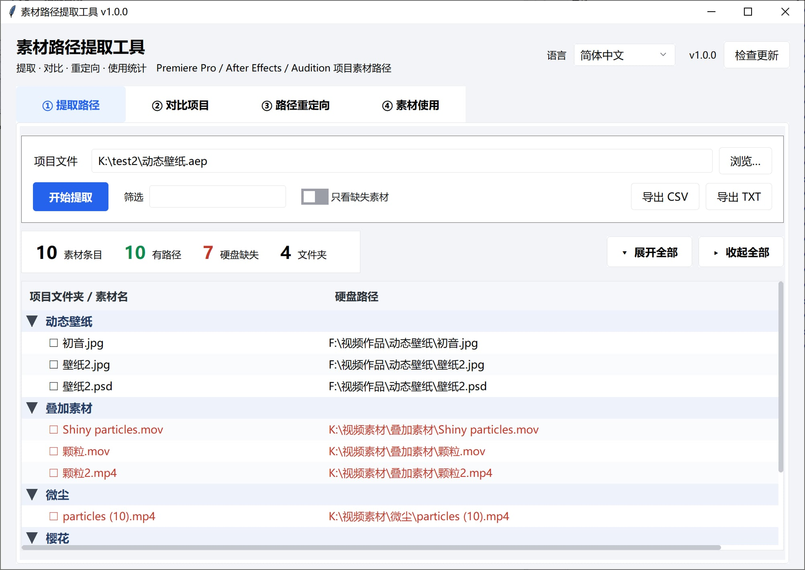

# 素材路径提取工具 · Asset Path Tool

[English](README.md) | [简体中文](README_SC.md) | [繁體中文](README_TC.md) | [日本語](README_JP.md)

提取 **Adobe Premiere Pro / After Effects / Audition** 工程里的素材路径，并支持对比、重定向、使用统计。



---

## 功能特点

| 功能 | 说明 |
|---|---|
| **① 提取路径** | 从 `.prproj` / `.aep` / `.aepx` / `.sesx` / `.xml` 里读出「项目文件夹 → 硬盘真实路径」，同时检查文件是否还在硬盘上。文件夹按树形折叠展示，支持展开全部 / 收起全部。 |
| **② 对比项目** | 两个工程互相比，分类列出**新增 / 删除 / 路径变化 / 位置变化 / 未变**。适合「这次改版动了哪些素材」「自动保存副本和主工程差在哪」。对比完可以一键「填到重定向表」。 |
| **③ 路径重定向** | 先列出全部素材路径，再按前缀规则批量换盘（`D:\` → `E:\`）；规则收在「规则表…」弹窗里，不占主界面。也可以双击某一行单独指定新位置。可选另存一份改写好的工程（`.prproj` / `.sesx`，**绝不覆盖原文件**）。 |
| **④ 使用统计** | 分析时间线，统计每个素材被用了几次、累计时长、出现在哪些序列，顺便揪出「一次都没用过」的素材。支持按文件夹 / 按类型汇总，连占用空间一起算。 |

其他：

- **拖放**：把工程文件直接拖进窗口，拖到哪个输入框就填哪个；对比页一次拖两个会自动分成 A / B。
  把**文件夹**拖到「查找缺失…」窗口上会填进「搜索目录」。
- **多选**：所有表格都支持 `Ctrl` 点选、`Shift` 连选；首列还有复选框，点表头一次全选，
  也可以用「勾选 / 全选 / 全不选」三个按钮批量操作。
- **右键菜单**：重定向表和「查找缺失…」结果表都能右键，直接「选择新位置…」/「清除手动指定」/「在资源管理器中定位」。
- **四语言**：简体中文 / 繁體中文 / English / 日本語，首次启动**自动跟随系统语言**，之后记住你的选择。
- **检查更新**：标题栏右侧有版本号和「检查更新」按钮，会读取 GitHub（连不上时自动改用 Gitee）最新的
  Release tag，并列出各平台下载地址。
- **命令行模式**：`--cli` 无界面直接出结果，方便批处理。
- **零依赖**：只用 Python 标准库（tkinter / xml / gzip / csv / re / ctypes），不用 pip 装任何东西。
- **现代界面**：内置 [tkwebui](https://github.com/bvb6417/tkwebui) 主题（纯标准库实现），高 DPI 屏下自动缩放。

## 支持的工程格式

| 软件 | 扩展名 | 提取 | 对比 | 重定向清单 | 改写工程 | 使用统计 |
|---|---|:---:|:---:|:---:|:---:|:---:|
| Premiere Pro | `.prproj` | ✅ | ✅ | ✅ | ✅ | ✅ |
| Premiere Pro | `.xml`（导出/解压后的 XML） | ✅ | ✅ | ✅ | — | ✅ |
| After Effects | `.aep` / `.aepx` | ✅ | ✅ | ✅ | ❌ | ❌ |
| Audition | `.sesx` | ✅ | ✅ | ✅ | ✅ | ❌ |

> **为什么 `.aep` 不能改写？**
> AE 工程是 RIFX（大端 RIFF）二进制容器，素材路径散落在 `LIST Als2` 里的一段段转义 JSON 中，
> 还有大量交叉索引和长度字段。直接改字节极易损坏工程，所以本工具对 `.aep` **只读**。
> 能提取路径已经够用来做备份清单和迁移核对了。
>
> **`.sesx` 可以改写**：纯文本 XML，只替换 `<file>` 开标签里的 `absolutePath` 属性值，
> 元素顺序、缩进、注释、换行符全都原样保留；`id` 不动，所以 fileID ↔ 路径的对应关系不受影响。
> `relativePath` 会按新位置重算，新文件跑到会话目录外面时这个属性会被删掉（留着旧的反而会打架）。
> UTF-8 BOM 原样带回。**同样只写新文件，绝不覆盖原会话。**

---

## 快速开始

### 方式一：下载打包好的版本（推荐）

到 [Releases](https://github.com/SaraKale/AssetPathTool/releases) 页面按平台下载：

| 平台 | 选哪个 |
|---|---|
| Windows | `windows-x64`（绝大多数电脑）；骁龙本选 `windows-arm64` |
| macOS | `macos-arm64`（M1/M2/M3/M4）；Intel 机器选 `macos-x64` |
| Linux | `linux-x64` 或 `linux-arm64` |

Windows / Linux 解压后直接运行 `AssetPathTool`（文件夹版，别单独拷 exe，`_internal` 要一起带着）。

GitHub 连不上时走镜像：

| 镜像 | 链接 |
|---|---|
| GitHub | https://github.com/SaraKale/AssetPathTool/releases |
| Gitee | https://gitee.com/sarakale/AssetPathTool/releases |
| 蓝奏云 | https://wwavg.lanzoum.com/b0rbjanfg（提取码 `914k`） |
| MediaFire | https://www.mediafire.com/folder/1ik8qiblrl7s1/AssetPathTool |

> macOS 首次打开若提示「无法验证开发者」，右键 → 打开，或在终端执行
> `xattr -dr com.apple.quarantine /path/to/AssetPathTool.app`。

### 方式二：从源码运行

需要 Python 3.9+（推荐 3.11 及以上），且带 tkinter。

```bash
git clone https://github.com/SaraKale/AssetPathTool
cd AssetPathTool
python AssetPathToolMain.py
```

Windows 上如果提示缺 tkinter，用官方安装包重装并勾选 `tcl/tk and IDLE`。

---

## 命令行用法

```bash
# 提取（.prproj / .aep / .sesx / .xml 都行）
python AssetPathToolMain.py --cli 项目.prproj
python AssetPathToolMain.py --cli 动效.aep
python AssetPathToolMain.py --cli 配音.sesx

# 对比两个工程
python AssetPathToolMain.py --cli 旧.prproj 新.prproj --diff

# 路径重定向（可重复给多条规则）
python AssetPathToolMain.py --cli 项目.prproj --remap "D:\旧素材" "E:\新素材"

# 使用统计
python AssetPathToolMain.py --cli 项目.prproj --usage

# 常用开关
--csv              同时导出 CSV
-o out.txt         指定输出文件
--rewrite out.prproj   另存一份改写后的工程（不覆盖原文件）
--all              对比时把序列 / 调整图层等无源文件条目也算进去
```

---

## 界面说明

### ① 提取路径

选好工程 → 点「开始提取」。上方四个数字是概览：素材条目 / 有路径 / 硬盘缺失 / 文件夹。

- 「筛选」框输入关键字，按文件夹名、素材名、路径实时过滤；
- 勾「只看缺失素材」只留硬盘上找不到的；
- 左侧 `▼ / ▶` 可以直接点，也可以点右上角「展开全部 / 收起全部」；
- 素材名最前面的 `☐` 点一下就勾上，方便把一批素材圈出来。

### ② 对比项目

A 填旧版本，B 填新版本 → 点「开始对比」。上方徽章显示五类变化各多少条，「只看」可以只看某一类。

默认会忽略序列、调整图层这类没有源文件的条目（否则结果会被噪音淹没），需要的话勾上「包含序列/调整图层等无源文件条目」。

**对比完可以直接接到重定向**：点「填到重定向表」，把这次对比出的「路径变化」逐条填进重定向页 ——
不用再自己看报告抄旧前缀 / 新前缀。重定向页还没加载项目时会先把 A（旧项目）填进去，
让你先「加载全部」；两边不是同一个项目时会先问一句。
想顺便把变化提炼成前缀规则（以后新增的素材也能自动套用），勾上「同时提炼前缀规则」——
整体换盘 / 搬目录的情况通常一条规则就够。

### ③ 路径重定向

1. 选工程 → 点「加载全部」，下方列出所有素材；
2. 点「规则表…」打开规则弹窗：填「原路径前缀 / 新路径前缀」→「+ 添加规则」。
   规则**从上到下匹配，命中第一条生效**，可以用「上移 / 下移」调整优先级；
3. 关掉弹窗（或直接在里面点「应用规则」）→ 主界面点「应用规则」批量换；
4. 个别素材想单独指定：**双击那一行**选新文件；右键可「选择新位置…」/「清除手动指定」/「在资源管理器中定位」；
5. 路径对不上时点「查找缺失…」，选一个素材目录，按**文件名前缀**去匹配（后缀不同也能认出来，`flv/mp4/mov` 互相认），相似度 ≥85% 的结果会自动勾上；
6. 确认无误后「导出清单」拿路径列表，或直接点「导出新文件」另存一份改写好的工程（**不覆盖原工程**）。

> **规则只对「当前这个工程」生效**：换一个工程文件重新「加载全部」，表格回到该工程自己的原路径，
> 上一批规则不会偷偷套上去（规则表里的规则还留着，想复用再点一次「应用规则」）。
> 换工程时如果当前有手动指定的新位置，会先问一句 —— 那些指定只属于原工程。

**导出按钮**（右上角，从左到右）：

| 按钮 | 产物 |
|---|---|
| **导出新文件** | 改写后的工程：`.prproj` 或 `.sesx`（按源文件类型自动决定），会先让你选保存位置；选到原工程路径会被拦住 |
| 导出清单 | `_重定向.txt` 路径对照表（在规则表里勾了「同时另存改写后的工程文件」时会顺带生成工程文件） |
| 导出 CSV | `_重定向.csv` 明细表，给 Excel 用 |

**查找缺失弹窗里也能右键**：`采用这个建议` / `选择新位置…` / `在资源管理器中定位`。
「采用这个建议」只应用右键点中的那一行；「选择新位置…」可以绕过匹配结果直接指定文件；
「定位」会打开资源管理器并选中文件。

结果表除了素材名和相似度，还列出候选文件的**大小**和**修改时间** ——
同名不同版本太常见（4K 修复版、压缩版、导出了两次），光看文件名和相似度判断不了，
有这两列就能一眼看出是不是同一个东西。

> **不选任何行直接点「应用到重定向表」= 全部应用**（每个素材取最佳候选）。
> 只改一部分就先 `Ctrl` / `Shift` 选中那几行再点。
>
> 一个缺失素材可能匹配出好几个候选（名字短的尤其容易）。
> 那不是重复行，是同一素材的备选。默认勾着「每个素材只留最佳候选」，低分备选不显示；
> 取消勾选就能看到全部，同一素材的第 2 条起素材名列显示 `└ 备选`，排在一起。
>
> 表格首列的 `☐` 是给「查找缺失…」圈范围的：勾了行就只处理勾选的行，没勾就处理选中的行，都没选才处理全部缺失。
>
> 批量勾选用「勾选 / 全选 / 全不选」三个按钮：
> - **勾选** —— 把表格里 `Ctrl` / `Shift` 选中的行打上勾；
> - **全选** —— 勾上当前「只看」筛选后**可见**的行（筛掉的不动）；
> - **全不选** —— **连筛掉的一起清空**，一个不留。
>
> 「清空手动指定」清的是**手动指定的新路径**（双击 / 右键选过的那些），
> 清完这些行会重新按规则计算，和勾选、筛选完全无关。

> ⚠️ 改写前请备份工程。改写产物是新文件，原工程一个字节都不会动。

### ④ 使用统计

选 `.prproj` → 「开始统计」。徽章给出素材总数 / 已使用 / 从未使用 / 序列数 / 时间线总时长。

右上角「视图」可以切换：

| 视图 | 看什么 |
|---|---|
| **逐条** | 每个素材一条：用了几次、累计多长、出现在哪些序列 |
| **按文件夹** | 每个项目文件夹一组：多少素材、多少没用过、共占多大 |
| **按类型** | 按视频 / 音频 / 图片分组，同上 |

「按文件夹」最实用的场景：硬盘快满了，先看哪个目录吃得最多、其中多少从来没用过
（实测一个 1152 素材的工程里，某个文件夹 42 个素材就占了 194 GB）。
「只看」筛选对汇总视图同样生效，可以只看「从未使用」的分组。
「逐条」视图按使用次数升序排列，没用过的排最前，一眼看出哪些素材是白买的。

**拖文件夹**：把文件夹拖到「查找缺失…」窗口上，会自动填进「搜索目录」；
窗口没开时把文件夹拖到主窗口，也会转过去（没开就提示你先打开）。

---

## 多语言

界面支持简体中文、繁體中文、English、日本語。右上角下拉框随时切换，**不重建窗口**，输入框里的路径和表格里的数据都还在。

首次启动会读系统 UI 语言自动选择；之后记住你的选择，配置文件就放在**程序旁边**，好找：

| 运行方式 | 配置文件位置 |
|---|---|
| 打包版 | 与 `AssetPathTool.exe` 同目录：`AssetPathTool.config.json` |
| 源码运行 | 项目根目录：`AssetPathTool.config.json` |
| 程序目录不可写（Program Files、macOS `.app` 内部、`/usr/local`） | `%APPDATA%\AssetPathTool\config.json`（macOS/Linux 为 `~/.config/AssetPathTool/`） |

因为是绿色版思路，**整个文件夹拷到另一台电脑，语言设置也跟着走**。想恢复「跟随系统」，删掉这个文件再启动即可。

新增一门语言：在 `src/i18n.py` 的 `LANGS` 加一行，再给 `_T` 的每条补一列。

---

## 构建打包

### 本机打包

```bash
pip install pyinstaller
pyinstaller AssetPathTool.spec --noconfirm
```

产物在 `dist/AssetPathTool/`。

`.spec` 里几个关键点：

| 项 | 值 | 原因 |
|---|---|---|
| `ONEFILE` | `False` | 文件夹版启动快；改成 `True` 就是一个单文件 exe（首次启动慢 1~3 秒） |
| 版本号 | 从 `src/appinfo.py` 的 `APP_VER` 读 | 唯一来源，exe 属性里的版本和标题栏永远一致 |
| `hiddenimports` | `collect_submodules("tkwebui")` + `collect_submodules("src")` | 主题和页面模块是动态加载的，不显式列会漏 |
| `excludes` | numpy / pandas / PyQt / PIL … | 从 200MB+ 压到 **31MB** |
| `console` | `False` | GUI 不要黑框；`--cli` 模式内部会自己接回控制台 |

### GitHub Actions

`.github/workflows/build-app.yml` 已经配好，六平台矩阵：

```
Windows x64 / Windows ARM64 / macOS Intel / macOS ARM64 / Linux x64 / Linux ARM64
```

触发方式：

- **推 tag**：`git tag v1.0.0 && git push origin v1.0.0` → 自动构建并创建 **Draft Release**；
- **手动**：Actions 页面 → Build Asset Path Tool → Run workflow，`release_tag` 填版本号（留空则只产出 artifact，不发 Release）。

---

## 项目结构

```
AssetPathToolMain.py        程序入口（GUI / CLI 分派）
AssetPathTool.spec          PyInstaller 打包配置
src/
  appinfo.py                应用名 / 版本号 / 配置目录
  i18n.py                   四语言文案表 + 系统语言检测
  theme.py                  调色板 + ttk 样式 + tkwebui 探测
  platform_utils.py         DPI / 控制台接管 / 文件拖放
  cli.py                    命令行模式
  core/                     纯解析逻辑（不依赖 tkinter）
    prproj.py               .prproj / .xml 解析
    aep.py                  .aep / .aepx 解析（RIFX + gzip XML）
    sesx.py                 .sesx（Audition）解析 + 改写
    loader.py               按扩展名分派（提取 / 改写都走这里）
    usage.py                时间线使用统计 + 分组汇总
    diff.py                 两工程对比 + 提炼重定向规则
    remap.py                前缀重定向 + 改写 .prproj
    matching.py             按文件名找缺失素材
    fsinfo.py               文件大小 / 修改时间
    update.py               查 GitHub / Gitee 最新 Release tag
  ui/                       界面层
    app.py                  主窗口骨架 / 语言切换 / 后台任务
    kit.py                  公共控件工厂
    page_extract.py         ① 提取
    page_diff.py            ② 对比
    page_remap.py           ③ 重定向
    page_usage.py           ④ 使用统计
    finder.py               「查找缺失…」弹窗
    update_win.py           「检查更新」弹窗
tkwebui/                    界面主题库（MIT，随项目分发）
```

`src/core/` 不 import tkinter，可以单独拿去做脚本或单元测试：

```python
from src.core.loader import extract_any
for r in extract_any("项目.prproj"):
    print(r["folder"], r["name"], r["exists"])
```

---

## 注意事项

- **`.prproj` 是 gzip 压缩的 XML**（magic `1f 8b`），本工具会自动解压，不需要你手动处理。
- **改写 `.prproj` 只写新文件**，原工程不会被修改；但改写属于实验性功能，**请务必先备份**，并先在 Premiere 里打开产物确认素材都在线。
- **素材是否「存在」取决于运行本工具的这台电脑**。在 A 电脑提取的清单拿到 B 电脑看，缺失数会不一样，这是正常的。
- **大工程需要时间**。1000+ 素材的工程解析约 1~2 秒；「查找缺失」扫描几十万文件的素材盘会更久，工具会提示你先缩小范围。
- **`.aep` 只读**，见上文说明；`.prproj` / `.sesx` 可以另存改写版，但**从不覆盖原文件**。
- **配置文件**是程序旁边的 `AssetPathTool.config.json`，只记录界面语言，删掉就等于恢复默认。

## 常见问题

**Q：提示缺少 tkinter？**
Windows 用 python.org 官方安装包重装，勾上 `tcl/tk and IDLE`；Ubuntu 执行 `sudo apt install python3-tk`；macOS 用 python.org 版本（brew 的 python 有时不带 tk）。

**Q：打包后的 exe 用 `--cli` 没输出？**
`console=False` 的 exe 在双击时没有控制台。请在 cmd / PowerShell 里运行，或用 `-o` 指定输出文件。注意 Git Bash / MinTTY 是 pty，接不上 Win32 控制台。

**Q：能提取 Premiere 的 `.xml` 吗？**
可以，选文件时直接选 `.xml` 即可。

**Q：Audition 的 `.sesx` 能提取吗？**
能，和 `.prproj` 一样拖进去就行。`.sesx` 是纯文本 XML，路径写在 `<file>` 元素的
`absolutePath` **属性**上（不是子标签），相对路径在 `relativePath` 里；
工具两者都读，还有绝对路径正则兜底，编码上 UTF-8 / GB18030 / UTF-16 都试。
Audition 没有 PR 那种「项目文件夹」，所以列表里按**素材所在目录**分组。

**Q：`.sesx` 提取出来是空的？**
早期版本只扫 `<filePath>` 子标签，而真实 Audition 会话用的是 `absolutePath`
属性，所以一条都读不到 —— 已在 v1.0.0 修复。如果还是空，工具会明确弹窗说明
可能原因（工程没引用外部素材 / 格式不支持 / 文件损坏）。

**Q：Audition 的 `.sesx` 能改写吗？**
能。只替换 `<file>` 开标签里的 `absolutePath` 属性值，`id`、元素顺序、缩进、注释、
换行符全都原样保留，UTF-8 BOM 也带回去。`relativePath` 会按新位置重算；
新文件跑到会话目录外面时这个属性会被删掉 —— 留着旧的相对路径反而会让 Audition 两边打架。
用真实会话实测：6 条路径全部命中，改完能重新解析，`id` 一个没变。

**Q：会改我的工程文件吗？**
提取、对比、统计都是只读。改写只在「导出新文件」或勾了「同时另存改写后的工程文件」时才发生，
而且永远写到新路径 —— 手选到原工程也会被拦住。

**Q：「检查更新」是怎么工作的？**
读 GitHub API 的最新 Release tag，连不上时自动改用 Gitee，再跟程序内置的版本号比大小。
发版时 tag 打成 `v<APP_VER>`，所以比较纯粹是数字比大小。不会自动下载或安装任何东西，
窗口只列出各平台下载地址。

---

## 许可

[MIT](LICENSE)

界面主题 [tkwebui](https://github.com/bvb6417/tkwebui) 同样是 MIT 许可，已随项目一起分发。
