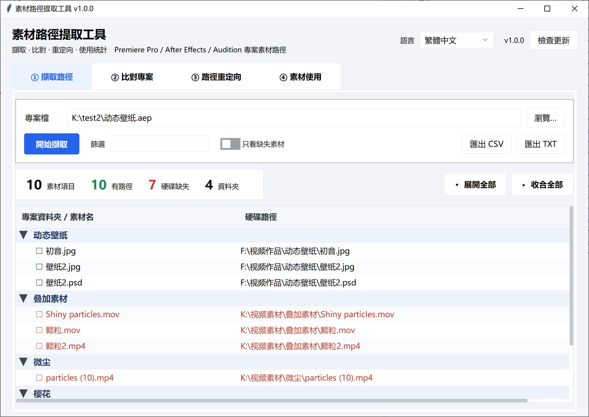

# 素材路徑提取工具 · Asset Path Tool

[English](README.md) | [简体中文](README_SC.md) | [繁體中文](README_TC.md) | [日本語](README_JP.md)

提取 **Adobe Premiere Pro / After Effects / Audition** 專案裡的素材路徑，並支援比對、重定向、使用統計。



---

## 功能特點

| 功能 | 說明 |
|---|---|
| **① 提取路徑** | 從 `.prproj` / `.aep` / `.aepx` / `.sesx` / `.xml` 裡讀出「專案資料夾 → 硬碟真實路徑」，同時檢查檔案是否還在硬碟上。資料夾以樹狀摺疊呈現，支援展開全部 / 收合全部。 |
| **② 比對專案** | 兩個專案互相對比，分類列出**新增 / 刪除 / 路徑變化 / 位置變化 / 未變**。適合「這次改版動了哪些素材」「自動儲存的副本和主專案差在哪」。比對完可以一鍵「填入重定向表」。 |
| **③ 路徑重定向** | 先列出全部素材路徑，再依前綴規則批次換碟（`D:\` → `E:\`）；規則收在「規則表…」彈窗裡，不佔主介面。也可以雙擊某一列單獨指定新位置。可選擇另存一份改寫好的專案（`.prproj` / `.sesx`，**絕不覆蓋原檔**）。 |
| **④ 使用統計** | 分析時間軸，統計每個素材被用了幾次、累計時長、出現在哪些序列，順便揪出「一次都沒用過」的素材。支援依資料夾 / 依類型彙總，連佔用空間一起算。 |

其他：

- **拖放**：把專案檔直接拖進視窗，拖到哪個輸入框就填哪個；比對頁一次拖兩個會自動分成 A / B。
  把**資料夾**拖到「尋找缺失…」視窗上會填進「搜尋目錄」。
- **多選**：所有表格都支援 `Ctrl` 點選、`Shift` 連選；首欄還有勾選框，點表頭一次全選，
  也可以用「勾選 / 全選 / 全不選」三個按鈕批次操作。
- **右鍵選單**：重定向表和「尋找缺失…」結果表都能右鍵，直接「選擇新位置…」/「清除手動指定」/「在檔案總管中定位」。
- **四語言**：简体中文 / 繁體中文 / English / 日本語，首次啟動**自動跟隨系統語言**，之後記住你的選擇。
- **檢查更新**：標題列右側有版本號和「檢查更新」按鈕，會讀取 GitHub（連不上時改用 Gitee）最新的 Release tag，並列出各平台下載位址。
- **命令列模式**：`--cli` 無介面直接出結果，方便批次處理。
- **零依賴**：只用 Python 標準庫（tkinter / xml / gzip / csv / re / ctypes），不用 pip 裝任何東西。
- **現代介面**：內建 [tkwebui](https://github.com/bvb6417/tkwebui) 主題（純標準庫實作），高 DPI 螢幕下自動縮放。

## 支援的專案格式

| 軟體 | 副檔名 | 提取 | 比對 | 重定向清單 | 改寫專案 | 使用統計 |
|---|---|:---:|:---:|:---:|:---:|:---:|
| Premiere Pro | `.prproj` | ✅ | ✅ | ✅ | ✅ | ✅ |
| Premiere Pro | `.xml`（匯出／解壓後的 XML） | ✅ | ✅ | ✅ | — | ✅ |
| After Effects | `.aep` / `.aepx` | ✅ | ✅ | ✅ | ❌ | ❌ |
| Audition | `.sesx` | ✅ | ✅ | ✅ | ✅ | ❌ |

> **為什麼 `.aep` 不能改寫？**
> AE 專案是 RIFX（大端 RIFF）二進位容器，素材路徑散落在 `LIST Als2` 裡一段段轉義過的 JSON 中，
> 還有大量交叉索引和長度欄位。直接改位元組極易損壞專案，所以本工具對 `.aep` **唯讀**。
> 能提取路徑已經夠用來做備份清單和搬移核對了。
>
> **`.sesx` 可以改寫**：純文字 XML，只替換 `<file>` 開標籤裡的 `absolutePath` 屬性值，
> 元素順序、縮排、註解、換行字元全都原樣保留；`id` 不動，所以 fileID ↔ 路徑的對應關係不受影響。
> `relativePath` 會依新位置重算，新檔案跑到工作階段目錄外面時這個屬性會被刪掉（留著舊的反而會打架）。
> UTF-8 BOM 原樣帶回。**同樣只寫新檔，絕不覆蓋原工作階段。**

---

## 快速開始

### 方式一：下載打包好的版本（推薦）

到 [Releases](https://github.com/SaraKale/AssetPathTool/releases) 頁面依平台下載：

| 平台 | 選哪個 |
|---|---|
| Windows | `windows-x64`（絕大多數電腦）；驍龍筆電選 `windows-arm64` |
| macOS | `macos-arm64`（M1/M2/M3/M4）；Intel 機器選 `macos-x64` |
| Linux | `linux-x64` 或 `linux-arm64` |

Windows / Linux 解壓後直接執行 `AssetPathTool`（資料夾版，別單獨拷 exe，`_internal` 要一起帶著）。

GitHub 連不上時可以走鏡像：

| 鏡像 | 連結 |
|---|---|
| GitHub | https://github.com/SaraKale/AssetPathTool/releases |
| Gitee | https://gitee.com/sarakale/AssetPathTool/releases |
| 藍奏雲 | https://wwavg.lanzoum.com/b0rbjanfg（提取碼 `914k`） |
| MediaFire | https://www.mediafire.com/folder/1ik8qiblrl7s1/AssetPathTool |

> macOS 首次開啟若提示「無法驗證開發者」，右鍵 → 打開，或在終端機執行
> `xattr -dr com.apple.quarantine /path/to/AssetPathTool.app`。

### 方式二：從原始碼執行

需要 Python 3.9+（建議 3.11 以上），且帶 tkinter。

```bash
git clone https://github.com/SaraKale/AssetPathTool
cd AssetPathTool
python AssetPathToolMain.py
```

Windows 上如果提示缺 tkinter，用官方安裝包重裝並勾選 `tcl/tk and IDLE`。

---

## 命令列用法

```bash
# 提取（.prproj / .aep / .sesx / .xml 都行）
python AssetPathToolMain.py --cli 專案.prproj
python AssetPathToolMain.py --cli 動效.aep
python AssetPathToolMain.py --cli 配音.sesx

# 比對兩個專案
python AssetPathToolMain.py --cli 舊.prproj 新.prproj --diff

# 路徑重定向（可重複給多條規則）
python AssetPathToolMain.py --cli 專案.prproj --remap "D:\舊素材" "E:\新素材"

# 使用統計
python AssetPathToolMain.py --cli 專案.prproj --usage

# 常用開關
--csv              同時匯出 CSV
-o out.txt         指定輸出檔案
--rewrite out.prproj   另存一份改寫後的專案（不覆蓋原檔）
--all              比對時把序列 / 調整圖層等無來源檔項目也算進去
```

---

## 介面說明

### ① 提取路徑

選好專案 → 點「開始提取」。上方四個數字是概覽：素材項目 / 有路徑 / 硬碟缺失 / 資料夾。

- 「篩選」框輸入關鍵字，依資料夾名、素材名、路徑即時過濾；
- 勾「只看缺失素材」只留硬碟上找不到的；
- 左側 `▼ / ▶` 可以直接點，也可以點右上角「展開全部 / 收合全部」；
- 素材名最前面的 `☐` 點一下就勾上，方便把一批素材圈出來。

### ② 比對專案

A 填舊版本，B 填新版本 → 點「開始比對」。上方徽章顯示五類變化各多少條，「只看」可以只看某一類。

預設會忽略序列、調整圖層這類沒有來源檔的項目（否則結果會被雜訊淹沒），需要的話勾上「包含序列／調整圖層等無來源檔項目」。

**比對完可以直接接到重定向**：點「填到重定向表」，把這次比對出的「路徑變化」逐條填進重定向頁 ——
不用再自己看報告抄舊前綴 / 新前綴。重定向頁還沒載入專案時會先把 A（舊專案）填進去，
讓你先「載入全部」；兩邊不是同一個專案時會先問一句。
想順便把變化提煉成前綴規則（以後新增的素材也能自動套用），勾上「同時提煉前綴規則」——
整體換碟 / 搬目錄的情況通常一條規則就夠。

### ③ 路徑重定向

1. 選專案 → 點「載入全部」，下方列出所有素材；
2. 點「規則表…」開啟規則彈窗：填「原路徑前綴 / 新路徑前綴」→「+ 新增規則」。
   規則**由上到下比對，命中第一條就生效**，可以用「上移 / 下移」調整優先順序；
3. 關掉彈窗（或直接在裡面點「套用規則」）→ 主介面點「套用規則」批次換；
4. 個別素材想單獨指定：**雙擊那一列**選新檔；右鍵可「選擇新位置…」/「清除手動指定」/「在檔案總管中定位」；
5. 路徑對不上時點「尋找缺失…」，選一個素材目錄，依**檔名前綴**去比對（副檔名不同也能認出來，`flv/mp4/mov` 互相認），相似度 ≥85% 的結果會自動勾上；
6. 確認無誤後「匯出清單」拿路徑列表，或直接點「匯出新檔案」另存一份改寫好的專案（**不覆蓋原專案**）。

**匯出按鈕**（右上角，從左到右）：

| 按鈕 | 產物 |
|---|---|
| **匯出新檔案** | 改寫後的專案：`.prproj` 或 `.sesx`（依來源檔類型自動決定），會先讓你選儲存位置；選到原專案路徑會被攔住 |
| 匯出清單 | `_重定向.txt` 路徑對照表（在規則表裡勾了「同時另存改寫後的專案檔」時會順帶產生專案檔） |
| 匯出 CSV | `_重定向.csv` 明細表，給 Excel 用 |

**尋找缺失彈窗裡也能右鍵**：`採用這個建議` / `選擇新位置…` / `在檔案總管中定位`。
「採用這個建議」只套用右鍵點中的那一列；「選擇新位置…」可以繞過比對結果直接指定檔案；
「定位」會開啟檔案總管並選取檔案。

結果表除了素材名和相似度，還列出候選檔的**大小**和**修改時間** ——
同名不同版本太常見（4K 修復版、壓縮版、匯出了兩次），光看檔名和相似度判斷不了，
有這兩欄就能一眼看出是不是同一個東西。

> **不選任何列直接點「套用到重定向表」= 全部套用**（每個素材取最佳候選）。
> 只改一部分就先 `Ctrl` / `Shift` 選中那幾列再點。
>
> 一個缺失素材可能比對出好幾個候選（名字短的尤其容易）。
> 那不是重複列，是同一素材的備選。預設勾著「每個素材只留最佳候選」，低分備選不顯示；
> 取消勾選就能看到全部，同一素材的第 2 條起素材名欄顯示 `└ 備選`，排在一起。
>
> 表格首欄的 `☐` 是給「尋找缺失…」圈範圍的：勾了列就只處理勾選的列，沒勾就處理選中的列，都沒選才處理全部缺失。
>
> 批次勾選用「勾選 / 全選 / 全不選」三個按鈕：
> - **勾選** —— 把表格裡 `Ctrl` / `Shift` 選中的列打上勾；
> - **全選** —— 勾上目前「只看」篩選後**可見**的列（篩掉的不動）；
> - **全不選** —— **連篩掉的一起清空**，一個不留。
>
> 「清除手動指定」清的是**手動指定的新路徑**（雙擊 / 右鍵選過的那些），
> 清完這些列會重新依規則計算，和勾選、篩選完全無關。

> ⚠️ 改寫前請備份專案。改寫產物是新檔，原專案一個位元組都不會動。

### ④ 使用統計

選 `.prproj` → 「開始統計」。徽章給出素材總數 / 已使用 / 從未使用 / 序列數 / 時間軸總時長。

右上角「檢視」可以切換：

| 檢視 | 看什麼 |
|---|---|
| **逐條** | 每個素材一列：用了幾次、累計多長、出現在哪些序列 |
| **依資料夾** | 每個專案資料夾一組：多少素材、多少沒用過、共佔多大 |
| **依類型** | 依影片 / 音訊 / 圖片分組，同上 |

「依資料夾」最實用的場景：硬碟快滿了，先看哪個目錄吃得最多、其中多少從來沒用過
（實測一個 1152 素材的專案裡，某個資料夾 42 個素材就佔了 194 GB）。
「只看」篩選對彙總檢視同樣生效，可以只看「從未使用」的分組。

**拖資料夾**：把資料夾拖到「尋找缺失…」視窗上，會自動填進「搜尋目錄」；
視窗沒開時把資料夾拖到主視窗，也會轉過去（沒開就提示你先開啟）。

---

## 多語言

介面支援简体中文、繁體中文、English、日本語。右上角下拉框隨時切換，**不重建視窗**，輸入框裡的路徑和表格裡的資料都還在。

首次啟動會讀系統 UI 語言自動選擇；之後記住你的選擇，設定檔就放在**程式旁邊**，好找：

| 執行方式 | 設定檔位置 |
|---|---|
| 打包版 | 與 `AssetPathTool.exe` 同目錄：`AssetPathTool.config.json` |
| 原始碼執行 | 專案根目錄：`AssetPathTool.config.json` |
| 程式目錄不可寫（Program Files、macOS `.app` 內部、`/usr/local`） | `%APPDATA%\AssetPathTool\config.json`（macOS/Linux 為 `~/.config/AssetPathTool/`） |

因為是綠色版思路，**整個資料夾拷到另一台電腦，語言設定也跟著走**。想恢復「跟隨系統」，刪掉這個檔案再啟動即可。

新增一門語言：在 `src/i18n.py` 的 `LANGS` 加一行，再給 `_T` 的每條補一欄。

---

## 建置打包

### 本機打包

```bash
pip install pyinstaller
pyinstaller AssetPathTool.spec --noconfirm
```

產物在 `dist/AssetPathTool/`。

`.spec` 裡幾個關鍵點：

| 項 | 值 | 原因 |
|---|---|---|
| `ONEFILE` | `False` | 資料夾版啟動快；改成 `True` 就是一個單檔 exe（首次啟動慢 1~3 秒） |
| 版本號 | 從 `src/appinfo.py` 的 `APP_VER` 讀 | 唯一來源，exe 屬性裡的版本和標題列永遠一致 |
| `hiddenimports` | `collect_submodules("tkwebui")` + `collect_submodules("src")` | 主題和頁面模組是動態載入的，不顯式列會漏 |
| `excludes` | numpy / pandas / PyQt / PIL … | 從 200MB+ 壓到 **31MB** |
| `console` | `False` | GUI 不要黑框；`--cli` 模式內部會自己接回主控台 |

### GitHub Actions

`.github/workflows/build-app.yml` 已經配好，六平台矩陣：

```
Windows x64 / Windows ARM64 / macOS Intel / macOS ARM64 / Linux x64 / Linux ARM64
```

觸發方式：

- **推 tag**：`git tag v1.0.0 && git push origin v1.0.0` → 自動建置並建立 **Draft Release**；
- **手動**：Actions 頁面 → Build Asset Path Tool → Run workflow，`release_tag` 填版本號（留空則只產出 artifact，不發 Release）。

---

## 專案結構

```
AssetPathToolMain.py        程式入口（GUI / CLI 分派）
AssetPathTool.spec          PyInstaller 打包設定
src/
  appinfo.py                應用名 / 版本號 / 設定目錄
  i18n.py                   四語言文案表 + 系統語言偵測
  theme.py                  調色盤 + ttk 樣式 + tkwebui 偵測
  platform_utils.py         DPI / 主控台接管 / 檔案拖放
  cli.py                    命令列模式
  core/                     純解析邏輯（不依賴 tkinter）
    prproj.py               .prproj / .xml 解析
    aep.py                  .aep / .aepx 解析（RIFX + gzip XML）
    sesx.py                 .sesx（Audition）解析 + 改寫
    loader.py               依副檔名分派（提取 / 改寫都走這裡）
    usage.py                時間軸使用統計 + 分組彙總
    diff.py                 兩專案比對 + 提煉重定向規則
    remap.py                前綴重定向 + 改寫 .prproj
    matching.py             依檔名尋找缺失素材
    fsinfo.py               檔案大小 / 修改時間
    update.py               查 GitHub / Gitee 最新 Release tag
  ui/                       介面層
    app.py                  主視窗骨架 / 語言切換 / 背景任務
    kit.py                  公用控制項工廠
    page_extract.py         ① 提取
    page_diff.py            ② 比對
    page_remap.py           ③ 重定向
    page_usage.py           ④ 使用統計
    finder.py               「尋找缺失…」彈窗
    update_win.py           「檢查更新」彈窗
tkwebui/                    介面主題庫（MIT，隨專案分發）
```

`src/core/` 不 import tkinter，可以單獨拿去做腳本或單元測試：

```python
from src.core.loader import extract_any
for r in extract_any("專案.prproj"):
    print(r["folder"], r["name"], r["exists"])
```

---

## 注意事項

- **`.prproj` 是 gzip 壓縮的 XML**（magic `1f 8b`），本工具會自動解壓，不需要你手動處理。
- **改寫 `.prproj` 只寫新檔**，原專案不會被修改；但改寫屬於實驗性功能，**請務必先備份**，並先在 Premiere 裡開啟產物確認素材都在線。
- **素材是否「存在」取決於執行本工具的這台電腦**。在 A 電腦提取的清單拿到 B 電腦看，缺失數會不一樣，這是正常的。
- **大專案需要時間**。1000+ 素材的專案解析約 1~2 秒；「尋找缺失」掃描幾十萬檔案的素材碟會更久，工具會提示你先縮小範圍。
- **`.aep` 唯讀**，見上文說明；`.prproj` / `.sesx` 可以另存改寫版，但**從不覆蓋原檔**。
- **設定檔**是程式旁邊的 `AssetPathTool.config.json`，只記錄介面語言，刪掉就等於恢復預設。

## 常見問題

**Q：提示缺少 tkinter？**
Windows 用 python.org 官方安裝包重裝，勾上 `tcl/tk and IDLE`；Ubuntu 執行 `sudo apt install python3-tk`；macOS 用 python.org 版本（brew 的 python 有時不帶 tk）。

**Q：打包後的 exe 用 `--cli` 沒輸出？**
`console=False` 的 exe 在雙擊時沒有主控台。請在 cmd / PowerShell 裡執行，或用 `-o` 指定輸出檔案。注意 Git Bash / MinTTY 是 pty，接不上 Win32 主控台。

**Q：能提取 Premiere 的 `.xml` 嗎？**
可以，選檔案時直接選 `.xml` 即可。

**Q：Audition 的 `.sesx` 能提取嗎？**
能，和 `.prproj` 一樣拖進去就行。`.sesx` 是純文字 XML，路徑寫在 `<file>` 元素的
`absolutePath` **屬性**上（不是子標籤），相對路徑在 `relativePath` 裡；
工具兩者都讀，還有絕對路徑正規表達式兜底，編碼上 UTF-8 / GB18030 / UTF-16 都試。
Audition 沒有 PR 那種「專案資料夾」，所以列表裡依**素材所在目錄**分組。

**Q：`.sesx` 提取出來是空的？**
早期版本只掃 `<filePath>` 子標籤，而真實 Audition 工作階段用的是 `absolutePath`
屬性，所以一條都讀不到 —— 已在 v1.0.0 修正。如果還是空，工具會明確彈窗說明
可能原因（專案沒引用外部素材 / 格式不支援 / 檔案損壞）。

**Q：Audition 的 `.sesx` 能改寫嗎？**
能。只替換 `<file>` 開標籤裡的 `absolutePath` 屬性值，`id`、元素順序、縮排、註解、
換行字元全都原樣保留，UTF-8 BOM 也帶回去。`relativePath` 會依新位置重算；
新檔案跑到工作階段目錄外面時這個屬性會被刪掉 —— 留著舊的相對路徑反而會讓 Audition 兩邊打架。
用真實工作階段實測：6 條路徑全部命中，改完能重新解析，`id` 一個沒變。

**Q：會改我的專案檔嗎？**
提取、比對、統計都是唯讀。改寫只在「匯出新檔案」或勾了「同時另存改寫後的專案檔」時才發生，
而且永遠寫到新路徑 —— 手選到原專案也會被攔住。

**Q：「檢查更新」是怎麼運作的？**
讀 GitHub API 的最新 Release tag，連不上時改用 Gitee，再跟程式內建的版本號比大小。
發版時 tag 打成 `v<APP_VER>`，所以比較純粹是數字比大小。不會自動下載或安裝任何東西，
視窗只列出各平台的下載位址。

---

## 授權

[MIT](LICENSE)

介面主題 [tkwebui](https://github.com/bvb6417/tkwebui) 同樣是 MIT 授權，已隨專案一起分發。
